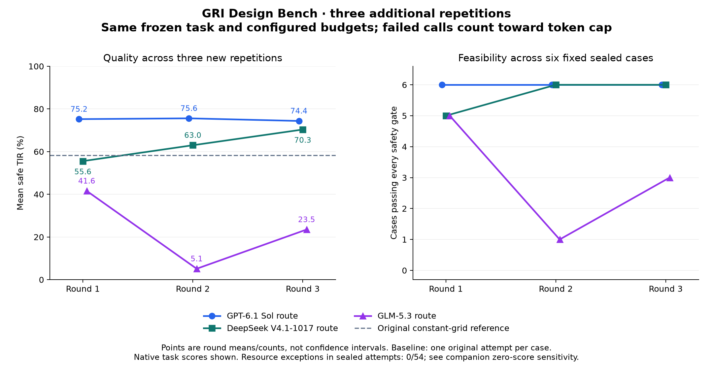

# GRI Design Bench

A small benchmark of **who can design a better static glucose-responsive insulin formulation** under a fixed simulation and compute budget. Version 0.1.1 contains **6 development and 6 sealed instances**, one task family, three known virtual patients per instance. It measures design and optimization in a public simulator, with fresh meal scenarios at evaluation.

This is an engineering pilot. It does not establish clinical efficacy, safety in real patients, generalization to unseen patients, or a stable ranking of foundation models. The 30 simglucose profiles were public and used in preceding studies. Material subranges are synthetic benchmark constraints inside an intentionally expanded prescreen design envelope; they are not newly measured formulations or a demonstrated manufacturing-feasibility region. See [bound provenance](docs/BOUND_PROVENANCE.md).

## Six additional open-weight routes

A [preregistered expansion](docs/MODEL_EXPANSION_2026_11_11.md) adds Qwen3.8-27B, MiniMax-M3.1-Flash, Kimi-K3.1-Pro, MiMo-V2.6-Pro, Step-5-Preview, and Intern-S2 through explicit Magpie routes. **216 new attempts are planned**, with three repetitions on each of the same twelve cases and unchanged per-trial budgets. All selected routes passed a non-benchmark mock tool roundtrip. Claude-family routes are excluded. The [model registry](experiments/expansion-2026-11-11/models.json) links official public weights and records the distinction between reference checkpoints and unverified API-served identities.

The existing results below remain unchanged. The eventual nine-route summary will label the earlier and later chronological batches rather than implying a newly interleaved nine-model experiment.

## Supplemental repetitions and budget correction

**All 108 additional trials are complete:** three routes × twelve fixed cases × three new contexts, following the [pre-run plan](experiments/repeats-2026-11-11/plan.json) published at `e225372` before execution. Cases, scientific contract, prompts, model settings and numeric budgets remain unchanged. Failed requests now consume their reserved completion allowance. The original pilot is retained separately.

On the six fixed sealed cases, the ordering was **GPT > DeepSeek > GLM in all three rounds**. Quality variability differs substantially:

| Requested route | Feasible /18 | R1 / R2 / R3 mean safe TIR (%) | Mean ± sample SD | Ranks |
|---|---:|---|---:|---|
| `codex/gpt-6.1-sol` | 18/18 | 75.22 / 75.59 / 74.37 | 75.06 ± 0.63 | 1 / 1 / 1 |
| `wanjie/deepseek-v4.1-flash-1017` | 17/18 | 55.56 / 62.99 / 70.35 | 62.97 ± 7.40 | 2 / 2 / 2 |
| `tokendance/glm-5.3` | 9/18 | 41.57 / 5.13 / 23.49 | 23.40 ± 18.22 | 3 / 3 / 3 |

SD is across three round means, not a confidence interval. All failures remain in the denominator. GPT passed the safety gates on every repetition of every sealed case, with a largest within-case score range of 3.87 percentage points. DeepSeek had one out-of-bounds submission; its remaining sealed designs passed the safety gates. GLM had three sealed submission failures and six safety failures, alongside 24 sealed API errors. Error requests and failed designs are separate counts; these observations do not isolate a causal effect of the route.

The [supplemental report](results/repetitions-2026-11-11/README.md) includes per-round ranks, within-case variability, failure categories, paired comparisons, CSV/JSON data, and an [independent audit](results/repetitions-2026-11-11/audit.json). The audit covers 964 API requests and 1,782 native trajectories from 99 valid designs; nine invalid submissions retain zero scores. All 367 original result files are byte-identical. One development trial recorded 30.311041 CPU seconds under the unchanged polling monitor; no sealed trial exceeded a recorded resource limit. A separately labelled, non-preregistered sensitivity analysis assigns zero to any over-limit attempt and leaves every round's ordering unchanged in both splits.



This is repeatability evidence on six already-used sealed cases, not a population-level model ranking or new unseen-case validation. The three-round ordering is consistent; DeepSeek and GLM show substantial score variation.

The [GLM diagnosis](docs/GLM_502_DIAGNOSIS.md) matched all 14 original HTTP 502 errors to reasoning-only output-limit exhaustion recorded by Magpie. Those failed calls reported 62,029 completion tokens that the original runner did not count. **10/12 original GLM trials therefore exceeded the nominal completion allowance.** Original scores and the `v0.1.1` tag remain unchanged as historical evidence; they must not be interpreted as strictly budget-compliant GLM results. The correction does not increase a limit or alter reasoning settings.

Output truncation remains present under the frozen settings: the supplemental study recorded 46 GLM HTTP 502 requests across development and sealed cases, all classified as reasoning-only output-limit exhaustion. Their full requested allowances were charged. No new trial exceeded the 18,000-token accounting limit, and no successful usage report exceeded its requested cap. This accounting repair does not claim to eliminate the underlying truncation.

## Original pilot results (retained)

**36 formal agent trials + 36 baseline trials, all independently resimulated.** The six sealed cases give the following descriptive results, sorted by feasible-case rate and then mean safe TIR. A safety-gate failure contributes zero to the mean.

| Method / requested route | Feasible sealed cases | Mean safe TIR (%) |
|---|---:|---:|
| `codex/gpt-6.1-sol` | 6/6 | 75.06 |
| `wanjie/deepseek-v4.1-flash-1017` | 6/6 | 73.02 |
| Constant-rate grid | 5/6 | 58.26 |
| Differential evolution | 5/6 | 54.39 |
| `tokendance/glm-5.3` | 5/6 | 44.99 |
| Sobol search | 5/6 | 44.93 |

Both GPT and DeepSeek routes produced feasible designs on all six sealed cases in this run. Six cases with one attempt each do not establish a stable ordering between models. The GLM route recorded 14 HTTP 502 requests across the full 12-case matrix (5 on sealed cases), subsequently traced to output-limit exhaustion. Its historical scores reflect that truncation, the frozen retry policy and the accounting defect described above. All 36 formal submissions were complete; no native solver failure occurred. Seven of the 72 agent/baseline designs failed a safety gate and retain their zero scores.

The [full leaderboard](results/pilot-v2/README.md), [machine-readable scores](results/pilot-v2/leaderboard.json), [failure/resource accounting](results/pilot-v2/FAILURES.md), and [independent audit](results/pilot-v2/audit.json) are included. The audit recomputed 1,296 native trajectories with maximum metric discrepancy 1.42 × 10⁻¹⁴. See [validation](docs/VALIDATION.md) and the separately retained [original development calibration](results/pilot-v1/CALIBRATION.md).


## Frozen boundary

The [original JSON contract](contract/contract.json) and two explicit amendments define the effective protocol. [Amendment 001](contract/amendment-001-models.json), requested before scored runs, replaces Opus with newer routed models and increases the pilot from 2 to 3 models. [Amendment 002](contract/amendment-002-interaction-budget.json) changes the interaction profile after development-only calibration, before any sealed model trial: 6 → 12 model calls, remaining-budget feedback, and an early-artifact reminder. CPU, wall time, total completion-token budget, cases, and scientific scores stay unchanged. Original failures remain archived separately.

- **Input:** known cohort, native TDI values, fixed material/finite-reservoir bounds, public physiology, and one provided training meal seed with ordinary/missed-lunch/large-dinner variants. Agents may generate additional training scenarios inside the same CPU budget; the simulator is public.
- **Output:** one shared static responsive parameter vector or constant rate, plus `search.py` and `rationale.md`. Dose amplitude and reservoir scale by each patient's TDI. No custom real-time controller or physiology edits.
- **Budget:** 1 CPU, 2 GiB memory, 30 cumulative container CPU seconds after JIT warmup; 90 tool wall seconds; 360 seconds including API waits; at most 12 model calls, 6,000 completion tokens per call and 18,000 per trial. The runner reserves 0.3 CPU seconds for monitoring/pause latency and reports observed CPU. Supplemental trials reserve each requested output cap, including failed requests, and release unused tokens only from valid successful usage reports. Original pilot accounting omitted failed usage and has the documented GLM violations above. All enforcement relies on the provider honoring the requested per-call cap; actual billing remains unavailable.
- **Independent evaluation:** native simglucose dopri5 resimulation over 3 days, 2 new seeds × 3 variants × 3 patients. First-day warmup is omitted from TIR/TBR but included in the minimum glucose check.
- **Safety gate:** EVERY patient/scenario must have TBR70 ≤ 4%, TBR54 ≤ 1%; EVERY minute including warmup must have glucose ≥ 40 mg/dL. Missing/invalid output and failed simulation score zero. Infrastructure errors remain visible separately.
- **Scores:** rank by feasible-case rate, then mean `safe_tir`. `safe_tir` is mean TIR [70,180] for a feasible design and zero otherwise. Raw TIR and worst-case safety are also reported. No explanation-based LLM judging.

## Run locally

Python 3.12, Docker with cgroup v2, and a shell are required. The first image build downloads scientific dependencies. No network is available inside trial containers. The pilot uses Linux/arm64 on an Apple M5 host; CPU-time-limited comparisons depend on hardware speed and should use a common environment.

```bash
python3.12 -m venv .venv
.venv/bin/python -m pip install setuptools==80.10.2 wheel==0.48.0
.venv/bin/python -m pip install --no-build-isolation -r requirements-lock.txt
.venv/bin/python -m pip install --no-deps -e .
.venv/bin/python -m pip install pytest==9.2.0
.venv/bin/python -m pytest -q
docker --context default build -t gri-bench:0.1.1 .

# One strong baseline on an open development instance.
.venv/bin/python -m gri_bench.runner --case dev-01 \
  --method differential_evolution --context default --tag my-run

# Independently resimulate the saved submission and export its result.
.venv/bin/python -m gri_bench.evaluate \
  private/runs/my-run/dev-01__differential_evolution__seed20261111 \
  --export results/my-run

# OpenAI-compatible routed agent; credentials remain only on the host.
export GRI_MODEL_BASE_URL=http://127.0.0.1:3425/v1
# If the endpoint requires it: export GRI_MODEL_API_KEY=...
.venv/bin/python -m gri_bench.repeat_runner --case dev-01 \
  --model YOUR_ROUTE --context default --tag my-agent
```

Commands in the original pilot use the local `colima-etbench` Docker context. Pass your own context for standalone trials. The suite script is the maintainer entry point for all 12 cases; it requires the private sealed inputs. Public users can reproduce the six development cases without them. The original private suite is never regenerated from public hashes.

The agent command uses the repaired token-accounting entry point. The original `gri_bench.runner --method agent` remains available solely to reproduce the archived pilot behavior. Official supplemental tags require the original image ID; standalone tags record their rebuilt image ID instead.

## Baselines and model evidence

Three frozen algorithms receive the same CPU cap: constant-rate log grid, scrambled Sobol search, and logarithmic differential evolution. Their training target uses a predeclared safety margin (3% / 0.5% / 45 mg/dL). Their 36 verified runs are reused from `pilot-v1`: they do not call an LLM and are unaffected by the interaction-profile change. Candidate counts are diagnostic only: a white-box simulator permits custom evaluations and approximations.

The model matrix is recorded in [pilot-models.json](contract/pilot-models.json): `codex/gpt-6.1-sol`, `wanjie/deepseek-v4.1-flash-1017`, and `tokendance/glm-5.3`; one original trial per instance/model plus three supplemental repetitions. Magpie aliases and API-returned model strings are recorded. They do **not** independently authenticate the upstream checkpoint or provider configuration. Inference effort is the provider default, temperature is requested as zero, and actual returned token usage is retained. Billing cost is unknown, not zero.

The identifier `seed20261111` is the baseline RNG seed and trial label. No LLM sampling seed is sent to the routed API; agent-written searches choose their own seeds. Temperature zero does not establish deterministic replay across providers.

[DeepSeek's official changelog](https://api-docs.deepseek.com/updates/) identifies the 1017 update. The [DeepSeek weight card](https://huggingface.co/deepseek-ai/DeepSeek-V4.1-Flash) lists MIT; the [GLM 5.3 card](https://huggingface.co/zai-org/GLM-5.3) publishes weights under its own GLM-5.3 license. These sources establish public model availability, not the identity behind a third-party route.

## Separation and audit

The Docker image has an explicit source allowlist. It contains no instance files, sealed seeds, account configuration, API key, Docker socket, or host repository mount. Each task receives only its own training instance. Containers run as a non-root user with networking disabled, a read-only root filesystem, no added capabilities, bounded writable tmpfs, and process/memory/CPU limits. They are paused while the host waits for a model response.

The verifier runs trusted code outside the agent container. It parses bounded regular-file JSON and never imports submitted Python. Search code and rationale are archived as evidence; their presence and Python syntax are checked, but full search-code replay is not a scored requirement. Archived model code is untrusted: reproduce it inside the task sandbox. Native trajectories and per-scenario metrics are retained. Public exports include development designs/transcripts/traces, aggregate sealed-case results, and SHA-256 hashes of private evidence. Complete sealed inputs, their evaluation seeds, traces, and transcripts remain private.

Supplemental publication suppresses private sealed bounds embedded in verifier error text. One diagnostic was redacted; its original export and private score are archived with [hash evidence](results/repetitions-2026-11-11/publication-redactions.json). No numeric score or submission was changed. The frozen evaluator remains unchanged, and the publication-only filter is separately tested and audited.

Some development agents generated extra training seeds whose numeric values coincide with sealed-case **training** seeds. These original development records are retained. Private evaluation seeds are distinct and were not found in the public export; training-seed overlap is disclosed in the publication audit.

The [sealed manifest](contract/sealed-manifest.json) commits all six private cases using SHA-256 with a random 256-bit salt in each case. Local Git history records contract freeze before search; this is not an independently timestamped public preregistration. Prompt, baseline, runner, and image are frozen before the scored matrix; technical repairs must retain earlier attempts and disclose why they were necessary.

## Scientific provenance

Physiology and meal bookkeeping derive from [simglucose 0.2.11](https://github.com/jxx123/simglucose), with native 13-state dynamics unchanged. A Numba RK4 implementation accelerates search; the native environment/dopri5 implementation verifies submissions. Continuous release avoids pump quantization. Meals scale by BW/86.0704. This benchmark introduces a finite reservoir for the constant comparator as well as the responsive design, and uses stricter trajectory-level safety than the earlier prescreens.

The previous v1 STOP and v2 CONTINUE prescreen findings are historical results, not benchmark scores, and were not modified. V2 exposed substantial individual hypoglycemia despite favorable aggregate relative TIR; the new benchmark therefore uses explicit absolute, per-trajectory safety gates. The gates are benchmark criteria, not validated clinical treatment recommendations.

MIT license for benchmark code; see [third-party notices](THIRD_PARTY_NOTICES.md) for simglucose attribution. Version and dependency locks, image ID, source commit, model request/response identity, budget consumption, errors, and artifact hashes accompany the results.
