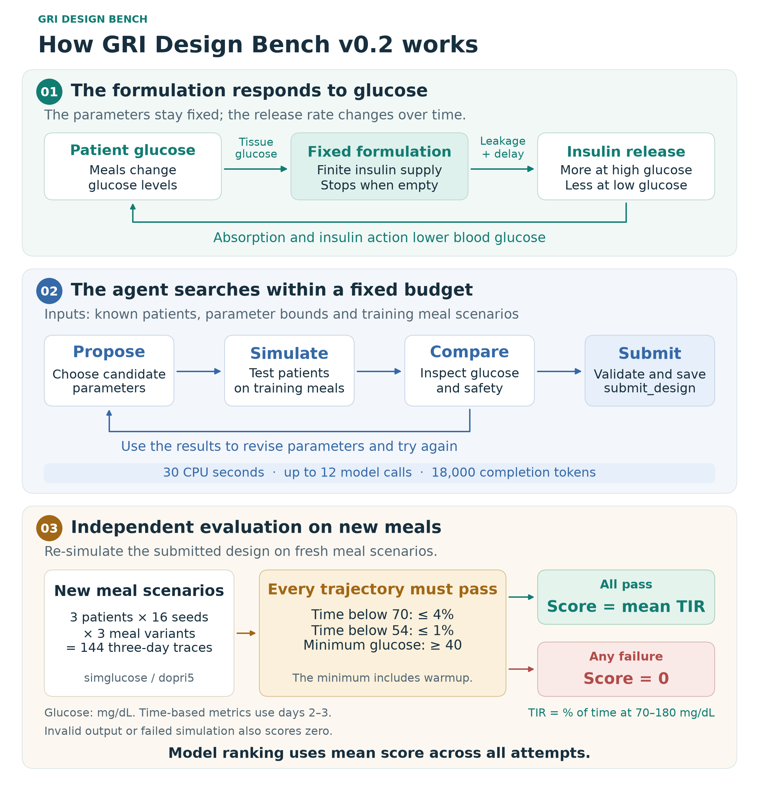

# GRI Design Bench

English · [简体中文](README.zh-CN.md)

GRI Design Bench compares how well AI agents design glucose-responsive insulin formulations under a fixed compute budget. Each agent chooses one set of formulation parameters for three virtual patients. It searches with a public simulator and submits a design for independent testing on new meal scenarios.

[](docs/assets/benchmark-overview-v02-en.svg)

## v0.2 nine-route results

Nine Magpie routes ran the same six development and six sealed cases three times each, for 324 model attempts. The table shows the 18 sealed attempts per route. Round ranks align repetition indices across the two batches.

| Rank | Model | Valid designs | Safety passes | Mean score (%) | Round ranks |
|---:|---|---:|---:|---:|---:|
| 1 | GPT-6.1 Sol | 18/18 | 18/18 | 73.11 | 1 / 1 / 1 |
| 2 | DeepSeek V4.1 Flash 1017 | 18/18 | 14/18 | 51.97 | 3 / 3 / 4 |
| 3 | MiniMax-M3.1-Flash | 16/18 | 14/18 | 51.82 | 5 / 2 / 2 |
| 4 | MiMo-V2.6-Pro | 15/18 | 11/18 | 46.47 | 2 / 5 / 3 |
| 5 | Kimi-K3.1-Pro | 18/18 | 14/18 | 44.23 | 4 / 4 / 5 |
| 6 | Step-5-Preview | 16/18 | 10/18 | 33.39 | 6 / 6 / 6 |
| 7 | GLM-5.3 | 18/18 | 9/18 | 20.95 | 7 / 7 / 8 |
| 8 | Qwen3.8-27B | 8/18 | 5/18 | 17.06 | 9 / 8 / 7 |
| 9 | Intern-S2 | 3/18 | 2/18 | 8.20 | 8 / 9 / 9 |

The constant and responsive baselines scored 49.48% and 58.03%. GPT-6.1 Sol scored +23.63 points relative to constant release, with a case-resampled 95% interval of [+9.04, +38.22].

GPT-6.1 Sol led in all three rounds. Across the three round pairs, Kendall's τ-b spanned 0.67–0.83. 7 of the 36 model pairs swapped order at least once. The second and third routes were 0.15 points apart, with a paired 95% interval of [-15.55, +16.03].

[Nine-route report and round data](results/v0.2/expansion-2026-11-13/README.md) · [Original three-route run](results/v0.2/sealed/README.md) · [Calibration](results/v0.2/calibration/README.md)

## The design problem

Insulin helps move glucose from the blood into cells. A person with type 1 diabetes needs replacement insulin. Too little leaves glucose high, while too much can cause hypoglycemia. The amount needed changes with meals and differs across patients. [Type 1 diabetes overview, NIDDK](https://www.niddk.nih.gov/health-information/diabetes/overview/what-is-diabetes/type-1-diabetes)

A glucose-responsive formulation acts like a valve attached to a finite insulin reservoir. Higher glucose in the surrounding tissue opens it further. The same formulation can release insulin slowly when glucose falls. Leakage, response delay and the remaining supply shape how much insulin is released. **The agent fixes the formulation parameters in advance. The release rate changes throughout the simulation.**

| Parameter | What it controls |
|---|---|
| `theta_a` | Overall release scale |
| `relative_leak` | Basal release when the glucose response is weak |
| `ec50_mg_dl` | Glucose level at half of the maximum responsive component |
| `hill_n` | How sharply release increases around that midpoint |
| `tau_min` | How quickly the formulation responds to changes in tissue glucose |
| `theta_L` | Total insulin available in the reservoir |

A larger dinner tests whether release rises enough. A missed lunch tests whether leakage and delayed responses cause low glucose when demand falls. A larger reservoir can sustain release over several days. How long it lasts depends on the release trajectory for each patient. The benchmark derives the release model from data on membrane-coated insulin crystals and uses synthetic bounds for the optimization task. [Xu et al. (2025)](https://pubmed.ncbi.nlm.nih.gov/40011600/) · [Release model](src/gri_bench/release.py) · [Material bounds](docs/BOUND_PROVENANCE.md)

## How a design earns a score

1. The agent receives the cohort, material bounds and two training meal seeds. It can use 30 CPU seconds to try candidates with the public simulator.
2. The agent calls `submit_design` with a static responsive design or a constant release rate. The host validates it and saves the latest accepted version. A single parameter vector applies to the cohort, with release and reservoir scaled by each patient's native daily insulin dose.
3. The verifier runs **144 three-day trajectories per design**. It combines three patients, 16 fresh meal seeds and three meal variants. It checks every trajectory for time below 70 mg/dL at most 4%, time below 54 mg/dL at most 1%, and minimum glucose at least 40 mg/dL across the full three days.

A design that passes earns its mean **time in range (TIR)**, the percentage of evaluated time at 70–180 mg/dL. The first day is warmup for time-based metrics. A TIR of 75% represents 36 of the remaining 48 hours in range. If any safety check fails or the agent submits no valid design, the attempt scores zero. The leaderboard averages all attempts. The equal-budget constant baseline shows how much benefit a search finds beyond a steady release rate. [v0.2 protocol](docs/v02/PROTOCOL.md)

## Run a development case

Use Python 3.12, curl and Docker with cgroup v2.

```bash
git clone https://github.com/ZJUZhiyuCai/gri-design-bench.git
cd gri-design-bench
python3.12 -m venv .venv
.venv/bin/python -m pip install setuptools==80.10.2 wheel==0.48.0
.venv/bin/python -m pip install --no-build-isolation -r requirements-lock.txt
.venv/bin/python -m pip install --no-deps -e .
docker --context default build -t gri-bench:0.1.1 .
docker --context default build -f Dockerfile.v02 -t gri-bench:0.2.0 .
.venv/bin/python -m gri_bench.v02.matrix --context default \
  --case dev-01 --output private/my-baseline
```

To run an agent on the same case, add `--model YOUR_ROUTE` and choose a new output directory. The runner uses `GRI_MODEL_BASE_URL` (default `http://127.0.0.1:3425/v1`) and the optional `GRI_MODEL_API_KEY`. It stores the submission, trial record and native score in the output directory.

[Development inputs](instances/dev/) · [Evaluation seeds](instances/v0.2/development-evaluation.json) · [Registered development plan](contract/v0.2/development-plan.json) · [Sealed commitments](contract/v0.2/sealed-manifest.json)

The [v0.1.1 archive](https://github.com/ZJUZhiyuCai/gri-design-bench/tree/31b8731f927691ccb4ed46064d3974dd5bf55373) contains the nine-route, 324-attempt comparison under the earlier task. The benchmark uses [simglucose 0.2.11](https://github.com/jxx123/simglucose) physiology, Numba RK4 for search and native dopri5 for scoring. [MIT license](LICENSE) · [Third-party notices](THIRD_PARTY_NOTICES.md)
