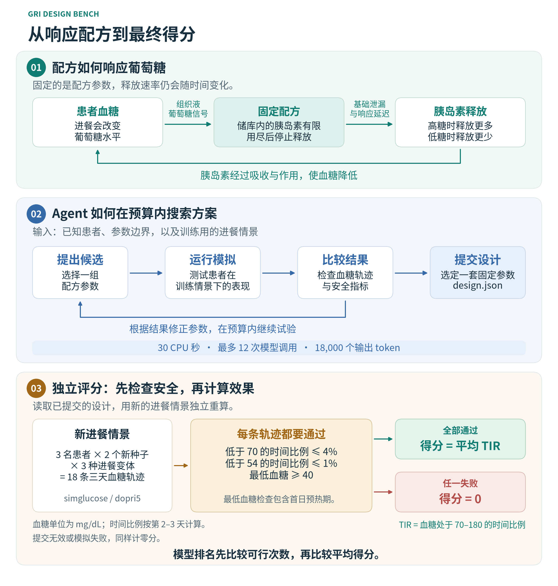
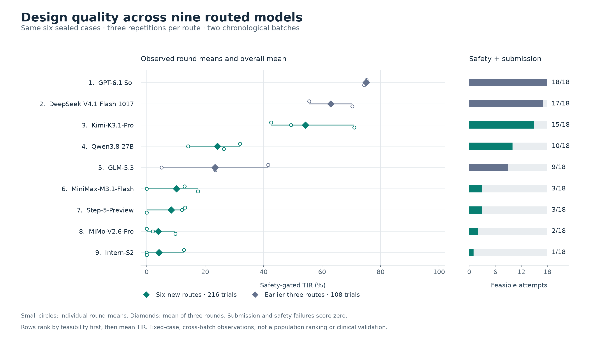

# GRI Design Bench

[English](README.md) · 简体中文

GRI Design Bench 衡量 AI Agent 在固定计算预算内设计葡萄糖响应胰岛素（GRI）配方的能力。每个任务要求 Agent 为三名虚拟患者设计一套固定配方，在公开模拟器中搜索，再由独立评测器用新的进餐情景检验效果。

v0.1.1 包含 **6 个开发实例和 6 个封存实例**，使用公开的虚拟患者生理模型和人工设定的材料约束。开发实例的输入公开，封存实例的完整输入由维护者保存。

[](docs/assets/benchmark-overview-zh-CN.svg)

## 这个问题为什么值得研究

胰岛素帮助血液中的葡萄糖进入细胞。1 型糖尿病患者自身产生的胰岛素很少或没有，需要补充胰岛素；补充不足会使血糖偏高，补充过量又可能使血糖降得过低。进餐量和胰岛素需求会变化，这使药物释放方案的设计面临两方面的约束。[NIDDK 的介绍说明了这一生理背景](https://www.niddk.nih.gov/health-information/diabetes/overview/what-is-diabetes/type-1-diabetes)。

这里的葡萄糖响应配方，可以理解为一个装有有限胰岛素、开度随葡萄糖浓度变化的阀门：葡萄糖升高时多释放，降低时少释放，同时受到基础泄漏、响应延迟和剩余药量的限制。**固定的是配方参数，释放速率仍会随时间变化。** Agent 要在评测开始前选好这套参数。

响应式设计的六个参数共同定义了[释放模型](src/gri_bench/release.py)：

| 设计选择 | 决定什么 |
|---|---|
| 释放强度（`theta_a`） | 单位时间释放药物的总体尺度 |
| 基础泄漏（`relative_leak`） | 葡萄糖触发的响应很弱时，仍会持续释放多少药物 |
| 响应中点（`ec50_mg_dl`） | 葡萄糖触发的响应部分达到最大值一半时的浓度 |
| 响应陡峭程度（`hill_n`） | 释放从弱响应过渡到强响应有多陡 |
| 响应延迟（`tau_min`） | 配方内部的葡萄糖信号跟随周围浓度变化的速度 |
| 储库大小（`theta_L`） | 一共装有多少可释放的胰岛素，用尽后释放停止 |

大份晚餐考验释放量是否足够，漏午餐考验需求降低后是否仍释放过多。增加释放量可能改善前期血糖，也可能增加低血糖风险，或让储库更早耗尽。同一套设计还要适用于三名生理参数不同的患者，因此任务要求在患者差异、进餐变化和多天供药之间寻找可行的平衡。

释放曲线的历史拟合数据来自 [Xu 等人的包膜胰岛素晶体研究](https://www.nature.com/articles/s41565-025-01860-0)。本 benchmark 将其抽象为只响应葡萄糖的释放模型，并扩展参数搜索范围，构建过程见[材料边界来源](docs/BOUND_PROVENANCE.md)。Agent 优化的是模拟中的释放行为，将参数实现为具体材料还需要后续实验。

## 结果

目前已完成 **9 个模型路由、324 次试测**：每个模型运行 12 个实例，每个实例重复 3 次。第一批测试 GPT、DeepSeek 和 GLM，第二批加入 6 个公开权重模型家族，沿用相同任务、提示词和配置预算。下表汇总两批试验在同一组 6 个封存实例上的结果，每个模型共 18 次尝试。

TIR（血糖达标时间比例）表示评测期间血糖处于 70–180 mg/dL 的时间占比。设计通过全部安全检查时，`safe_tir` 等于其平均 TIR，否则计零。排名先比较可行次数，再比较平均 `safe_tir`，所有尝试均纳入平均值。**SD 是三轮均值的样本标准差。**

| 排名 | 模型 | 批次 | 可行次数 /18 | 平均 safe TIR（%）± SD |
|---:|---|---|---:|---:|
| 1 | GPT-6.1 Sol | 前三模型 | 18/18 | 75.06 ± 0.63 |
| 2 | DeepSeek V4.1 Flash 1017 | 前三模型 | 17/18 | 62.97 ± 7.40 |
| 3 | Kimi-K3.1-Pro | 新增 6 个 | 15/18 | 54.31 ± 14.86 |
| 4 | Qwen3.8-27B | 新增 6 个 | 10/18 | 24.17 ± 9.07 |
| 5 | GLM-5.3 | 前三模型 | 9/18 | 23.40 ± 18.22 |
| 6 | MiniMax-M3.1-Flash | 新增 6 个 | 3/18 | 10.17 ± 9.09 |
| 7 | Step-5-Preview | 新增 6 个 | 3/18 | 8.40 ± 7.29 |
| 8 | MiMo-V2.6-Pro | 新增 6 个 | 2/18 | 3.99 ± 5.18 |
| 9 | Intern-S2 | 新增 6 个 | 1/18 | 4.25 ± 7.36 |

GPT 的 18 次封存试测均产出了可行设计。新增六模型中，Kimi 和 Qwen 连续三轮位列第一、第二，但两者的轮均分分别在 42.57–71.02 和 14.20–31.94 之间波动。其余四个模型的名次随轮次变化。

失败分类揭示了不同的难点。Kimi 的 18 次提交都有效，其中 3 个设计未通过安全检查；Qwen 有 1 次提交失败和 7 次安全失败。MiniMax 的 18 次尝试中有 14 次提交失败。Kimi 和 Qwen 的结果暴露出满足生理约束的难度，MiniMax 的大量失分则发生在设计进入模拟之前。因此，平均分同时反映方案质量和完成任务的可靠性。



新增 216 次试测中，有 13 次记录到资源超限。[严格超限计零分析](results/expansion-2026-11-11/README.md#resource-limit-sensitivity)将这些尝试计零后，封存集总体排名不变，Intern 的可行次数降为 0/18。上表保留原始模拟评分。

这些分数反映模型通过路由完成任务的整体表现，包含提交失败和 API 错误的影响；评测使用的是此前已运行过的六个封存实例。模型名对应请求的 Magpie 路由，实际服务的上游检查点尚未独立验证。[完整报告](results/expansion-2026-11-11/README.md)提供逐轮排名、失败分类、资源消耗以及 [CSV](results/expansion-2026-11-11/leaderboard.csv) 和 [JSON](results/expansion-2026-11-11/summary.json) 数据。

## 任务与评分

Agent 获得三名患者的生理参数、各自的每日胰岛素总量（TDI）、材料与储库边界，以及一个训练进餐种子。训练情景包含正常进餐、漏午餐和大份晚餐；Agent 可以在预算内使用公开模拟器生成更多训练情景。

提交物包括 `design.json`、`search.py` 和 `rationale.md`。设计可以采用固定的葡萄糖响应参数，也可以采用恒定释放速率。三名患者共用一套参数，剂量幅度和储库容量按各自 TDI 缩放。设计空间限定为静态配方，不包含实时控制器、餐时追加剂量或生理模型修改。

试测过程中，Agent 可以阅读模拟器代码、编写搜索程序、测试候选方案并检查血糖结果。它需要在预算内分配探索、验证和保存方案的时间。评测器随后读取 `design.json`，独立计算 **18 条三天轨迹**：3 名患者 × 2 个评测种子 × 3 种进餐情景。每条轨迹就是一名患者在一种进餐情景下连续三天的血糖变化记录。新的评测种子用于检验设计能否适应训练样例之外的进餐变化。搜索代码和设计说明作为审计材料保留，分数由独立模拟的轨迹计算。

可行设计必须让每条轨迹同时满足以下条件：

- 血糖低于 70 mg/dL 的时间比例不超过 4%。
- 血糖低于 54 mg/dL 的时间比例不超过 1%。
- 包括首日预热期在内，血糖始终不低于 40 mg/dL。

达标时间和低血糖时间比例均排除首日预热期，每条轨迹剩下 48 小时用于计分。原始 TIR 为 75%，相当于这 48 小时中有 36 小时血糖达标。举一个假设例子：方案 A 的平均 TIR 为 85%，但让一名患者的血糖降到 35 mg/dL，因此 `safe_tir` 为零；方案 B 的平均 TIR 为 75%，且所有轨迹均通过安全检查，得分就是 75。要求每条轨迹都通过，是为了避免良好的群体平均值掩盖个别患者的严重失败。[任务契约](contract/contract.json)、[模型修订](contract/amendment-001-models.json)和[交互预算修订](contract/amendment-002-interaction-budget.json)共同定义评测规则。

每次尝试的预算如下：

| 资源 | 上限 |
|---|---|
| 计算 | 1 CPU、2 GiB 内存；JIT 预热后累计 30 CPU 秒 |
| 实际耗时 | 工具调用累计 90 秒；包含 API 等待在内总计 360 秒 |
| 模型调用 | 最多 12 次；每次最多 6,000 个输出 token，每次试测累计最多 18,000 个 |

每个请求先预留完整输出额度，失败请求同样扣除；只有成功请求返回有效用量时，才释放未使用的额度。模型请求温度为零，推理设置采用服务方默认值。按 CPU 时间限制的比较需要使用相同硬件，本轮运行环境为 Apple M5 主机上的 Linux/arm64。

三个固定基线给出传统搜索方法在相同 CPU 上限下的表现。恒定速率网格搜索测试简单的释放方案；Sobol 搜索尽量均匀覆盖六维响应参数空间；差分进化根据已有候选方案继续搜索。它们的[单轮封存集分数](results/expansion-2026-11-11/README.md#fixed-baseline-reference)分别为 58.26、44.93 和 54.39，均有 5/6 个可行实例。

## 运行一个开发实例

需要 Python 3.12 和支持 cgroup v2 的 Docker。公开仓库包含六个开发实例及其评测输入；复现封存试测还需要维护者持有的私有输入。

安装锁定依赖并构建试测镜像：

```bash
git clone https://github.com/ZJUZhiyuCai/gri-design-bench.git
cd gri-design-bench
python3.12 -m venv .venv
.venv/bin/python -m pip install setuptools==80.10.2 wheel==0.48.0
.venv/bin/python -m pip install --no-build-isolation -r requirements-lock.txt
.venv/bin/python -m pip install --no-deps -e .
.venv/bin/python -m pip install pytest==9.2.0
.venv/bin/python -m pytest -q
docker --context default build -t gri-bench:0.1.1 .
```

在 `dev-01` 上运行差分进化，再独立评测保存的设计：

```bash
.venv/bin/python -m gri_bench.runner --case dev-01 \
  --method differential_evolution --context default --tag my-run

.venv/bin/python -m gri_bench.evaluate \
  private/runs/my-run/dev-01__differential_evolution__seed20261111 \
  --export results/my-run
```

测试 Agent 时，配置兼容 OpenAI 的接口，并使用修正了 token 记账的运行入口：

```bash
export GRI_MODEL_BASE_URL=http://127.0.0.1:3425/v1
# 如接口需要认证，请设置 GRI_MODEL_API_KEY。
.venv/bin/python -m gri_bench.repeat_runner --case dev-01 \
  --model YOUR_ROUTE --context default --tag my-agent
```

将 `YOUR_ROUTE` 替换为接口中的模型标识，将 `default` 替换为你的 Docker context。凭据保留在宿主机上，试测容器关闭网络访问；归档的 Agent 代码应在该沙箱内运行。

## 验证与项目记录

[扩测审计](results/expansion-2026-11-11/audit.json)独立重算了 112 个有效设计的 2,016 条原生轨迹，并核验全部 1,608 次 API 请求的额度预留记录。此前 799 个结果文件的哈希保持一致。公开测试集包含 39 项测试，覆盖生理模拟、评分、提交校验、预算记账和结果分析。

开发集公开设计、交互记录和轨迹；封存集公开汇总分数与私有证据哈希。[验证记录](docs/VALIDATION.md)说明沙箱检查、隐私检查、协议冻结和结果保存情况。

| 文档 | 内容 |
|---|---|
| [九模型扩测报告](results/expansion-2026-11-11/README.md) | 当前比较、三轮波动、失败分类与资源超限分析 |
| [前三模型重复试测](results/repetitions-2026-11-11/README.md) | 修正 token 记账后的 108 次试测 |
| [初始试测](results/pilot-v2/README.md) | 归档的模型与基线结果 |
| [GLM 路由诊断](docs/GLM_502_DIAGNOSIS.md) | 输出上限耗尽，以及原运行器漏记失败请求 token 的问题 |
| [扩测协议](docs/MODEL_EXPANSION_2026_11_11.md) | 模型选择、固定预算及 216 次试测前公开的计划 |
| [新增模型注册表](experiments/expansion-2026-11-11/models.json) | 六个新增模型的路由、公开权重来源与许可证 |
| [材料边界来源](docs/BOUND_PROVENANCE.md) | 人工设定的设计约束如何构建 |

初始 GLM 试测因漏记失败请求用量，有 10/12 次超过名义 token 预算。这批结果单独归档，当前榜单使用修正后的记账规则。

生理模型来自 [simglucose 0.2.11](https://github.com/jxx123/simglucose)。搜索使用 Numba RK4 加速，提交设计由原生 dopri5 评测器验证。Benchmark 代码采用 [MIT 许可证](LICENSE)，依赖归属见[第三方声明](THIRD_PARTY_NOTICES.md)。
