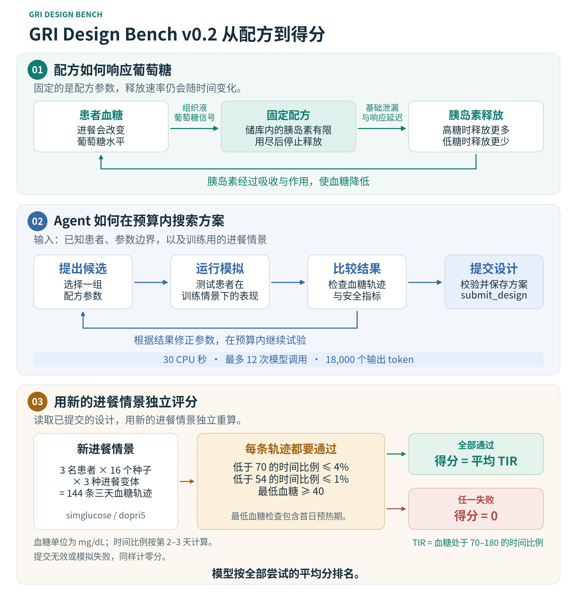

# GRI Design Bench

[English](README.md) · 简体中文

GRI Design Bench 比较 AI Agent 在固定计算预算内设计葡萄糖响应胰岛素配方的能力。Agent 要为三名虚拟患者选定一套配方参数，先用公开模拟器搜索，再把方案交给独立评测器，用新的进餐情景检验。

[](docs/assets/benchmark-overview-v02-zh-CN.svg)

## v0.2 九模型结果

九条 Magpie 路由在同一组 6 个开发实例和 6 个封存实例上各重复 3 次，共 324 次模型试测。下表为封存集成绩，每条路由有 18 次尝试。三轮名次按两批试测的重复编号合并。

| 排名 | 模型 | 合法提交 | 安全通过 | 平均分（%） | 三轮名次 |
|---:|---|---:|---:|---:|---:|
| 1 | GPT-6.1 Sol | 18/18 | 18/18 | 73.11 | 1 / 1 / 1 |
| 2 | DeepSeek V4.1 Flash 1017 | 18/18 | 14/18 | 51.97 | 3 / 3 / 4 |
| 3 | MiniMax-M3.1-Flash | 16/18 | 14/18 | 51.82 | 5 / 2 / 2 |
| 4 | MiMo-V2.6-Pro | 15/18 | 11/18 | 46.47 | 2 / 5 / 3 |
| 5 | Kimi-K3.1-Pro | 18/18 | 14/18 | 44.23 | 4 / 4 / 5 |
| 6 | Step-5-Preview | 16/18 | 10/18 | 33.39 | 6 / 6 / 6 |
| 7 | GLM-5.3 | 18/18 | 9/18 | 20.95 | 7 / 7 / 8 |
| 8 | Qwen3.8-27B | 8/18 | 5/18 | 17.06 | 9 / 8 / 7 |
| 9 | Intern-S2 | 3/18 | 2/18 | 8.20 | 8 / 9 / 9 |

恒速和响应式基线分别得 49.48% 和 58.03%。GPT-6.1 Sol 相对恒速基线的分差为 +23.63 个百分点，按实例重采样的 95% 区间为 [+9.04, +38.22]。

GPT-6.1 Sol 三轮均居首。九条路由的轮间 Kendall τ-b 为 0.67–0.83，36 对路由中有 7 对的相对顺序发生反转。总榜第二和第三仅差 0.15 个百分点，按实例配对重采样的 95% 区间为 [-15.55, +16.03]。

[九模型报告与逐轮数据](results/v0.2/expansion-2026-11-13/README.md) · [首批三模型](results/v0.2/sealed/README.md) · [校准和长预算搜索](results/v0.2/calibration/README.md)

## 这个设计问题在考什么

胰岛素帮助血液中的葡萄糖进入细胞。1 型糖尿病患者需要补充胰岛素，补得太少会使血糖偏高，补得太多会引发低血糖。进餐和患者之间的生理差异都会改变胰岛素需求。[NIDDK 的 1 型糖尿病介绍](https://www.niddk.nih.gov/health-information/diabetes/overview/what-is-diabetes/type-1-diabetes)

葡萄糖响应配方可以理解成一个连着有限胰岛素储库的阀门。周围组织液的葡萄糖升高时，阀门开得更大，葡萄糖降低时则释放得更慢。基础泄漏、响应延迟和剩余药量都会影响实际释放量。**Agent 事先选定配方参数，释放速率在模拟中随葡萄糖变化。**

| 参数 | 决定什么 |
|---|---|
| `theta_a` | 整体释放强度 |
| `relative_leak` | 葡萄糖响应很弱时仍有多少基础释放 |
| `ec50_mg_dl` | 响应部分达到最大值一半时的葡萄糖浓度 |
| `hill_n` | 释放量在响应中点附近升得有多陡 |
| `tau_min` | 配方跟随组织液葡萄糖变化的速度 |
| `theta_L` | 储库里可释放的胰岛素总量 |

大份晚餐考验配方能否增加释放量，漏午餐则考验基础释放和响应延迟会不会在需求降低时引起低血糖。更大的储库有助于维持多天供药，能用多久取决于每名患者对应的释放轨迹。释放模型源于包膜胰岛素晶体的数据，搜索边界由 benchmark 人工设定。[Xu 等，2025](https://pubmed.ncbi.nlm.nih.gov/40011600/) · [释放模型](src/gri_bench/release.py) · [材料边界来源](docs/BOUND_PROVENANCE.md)

## 一个方案如何得分

1. Agent 获得患者组合、材料边界和两个训练进餐种子，用公开模拟器搜索候选方案，累计可用 30 CPU 秒。
2. Agent 通过 `submit_design` 提交响应式配方或恒速释放方案。评测宿主校验参数并保存最近一次合法提交。三名患者共用一套参数，释放强度和储量按各自的每日胰岛素总量缩放。
3. 独立评测器为每份设计计算 **144 条三天轨迹**，涵盖三名患者、16 个新种子和三种进餐变体。每条轨迹中，低于 70 mg/dL 的时间最多占 4%，低于 54 mg/dL 的时间最多占 1%，三天内的最低血糖至少为 40 mg/dL。

全部通过时，得分为平均**血糖达标时间比例（TIR）**，即血糖处于 70–180 mg/dL 的时间占比。首日用来预热，TIR 为 75% 相当于剩下 48 小时里有 36 小时达标。任一安全检查失败或没有合法设计，该次尝试计零。排行榜取全部尝试的均分。同预算的恒速对照显示 Agent 找到的方案相对简单释放策略提高了多少。[v0.2 评测规则](docs/v02/PROTOCOL.md)

## 运行一个开发实例

需要 Python 3.12、curl 和支持 cgroup v2 的 Docker。

```bash
git clone https://github.com/ZJUZhiyuCai/gri-design-bench.git
cd gri-design-bench
python3.12 -m venv .venv
.venv/bin/python -m pip install setuptools==80.10.2 wheel==0.48.0
.venv/bin/python -m pip install --no-build-isolation -r requirements-lock.txt
.venv/bin/python -m pip install --no-deps -e .
docker --context default build -t gri-bench:0.1.1 .
docker --context default build -f Dockerfile.v02 -t gri-bench:0.2.0 .
.venv/bin/python -m gri_bench.v02.matrix --context default \
  --case dev-01 --output private/my-baseline
```

要在同一实例上运行 Agent，加入 `--model YOUR_ROUTE` 并另选一个输出目录。运行器读取 `GRI_MODEL_BASE_URL`（默认 `http://127.0.0.1:3425/v1`）和可选的 `GRI_MODEL_API_KEY`，把提交设计、运行记录和原生评测分数保存到输出目录。

[开发实例](instances/dev/) · [评测种子](instances/v0.2/development-evaluation.json) · [开发试测注册计划](contract/v0.2/development-plan.json) · [封存实例哈希承诺](contract/v0.2/sealed-manifest.json)

[v0.1.1 归档](https://github.com/ZJUZhiyuCai/gri-design-bench/tree/31b8731f927691ccb4ed46064d3974dd5bf55373)保存上一版九条模型路由、324 次试测的完整对比。生理模型来自 [simglucose 0.2.11](https://github.com/jxx123/simglucose)，搜索使用 Numba RK4，独立评分使用原生 dopri5。[MIT 许可证](LICENSE) · [第三方声明](THIRD_PARTY_NOTICES.md)
