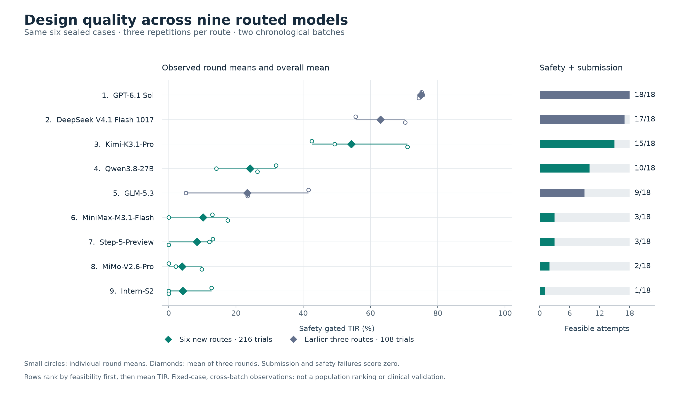

# Six additional model routes

**216 new attempts are complete:** six routes × twelve fixed cases × three fresh contexts. The nine-route aggregate contains 324 attempts under strict token accounting, combining this expansion with the earlier 108 attempts. Every planned failure remains in the denominator.

The [preregistered protocol](../../docs/MODEL_EXPANSION_2026_11_11.md) preserves the task, prompts, image, scoring and per-trial budgets. The [model registry](../../experiments/expansion-2026-11-11/models.json) links official open weights; API-served checkpoint identities are not independently authenticated. Claude-family routes are excluded.

## Nine-route sealed-case aggregate

Rank by feasible-case rate, then mean safety-gated TIR; ties share average rank. Each route has 18 sealed attempts. **SD is the sample SD of three round means, not a confidence interval.** The earlier three routes and the new six routes are different chronological batches.

| Rank | Model / requested route | Batch | Feasible /18 | Mean safe TIR (%) ± SD | R1 / R2 / R3 means |
|---:|---|---|---:|---:|---|
| 1 | GPT-6.1 Sol · `codex/gpt-6.1-sol` | Earlier three | 18/18 | 75.06 ± 0.63 | 75.22 / 75.59 / 74.37 |
| 2 | DeepSeek V4.1 Flash 1017 · `wanjie/deepseek-v4.1-flash-1017` | Earlier three | 17/18 | 62.97 ± 7.40 | 55.56 / 62.99 / 70.35 |
| 3 | Kimi-K3.1-Pro · `workbuddy/kimi-k3.1-pro` | New six | 15/18 | 54.31 ± 14.86 | 42.57 / 49.33 / 71.02 |
| 4 | Qwen3.8-27B · `atria/qwen3.8-27b` | New six | 10/18 | 24.17 ± 9.07 | 31.94 / 14.20 / 26.37 |
| 5 | GLM-5.3 · `tokendance/glm-5.3` | Earlier three | 9/18 | 23.40 ± 18.22 | 41.57 / 5.13 / 23.49 |
| 6 | MiniMax-M3.1-Flash · `minimax-code/MiniMax-M3.1-Flash` | New six | 3/18 | 10.17 ± 9.09 | 13.00 / 0.00 / 17.51 |
| 7 | Step-5-Preview · `workbuddy/step-5-preview` | New six | 3/18 | 8.40 ± 7.29 | 13.13 / 12.06 / 0.00 |
| 8 | MiMo-V2.6-Pro · `tokendance/mimo-v2.6-pro` | New six | 2/18 | 3.99 ± 5.18 | 0.00 / 2.13 / 9.85 |
| 9 | Intern-S2 · `atria/intern-s2` | New six | 1/18 | 4.25 ± 7.36 | 12.75 / 0.00 / 0.00 |

## Repeatability within the six new routes

The ranks below compare only the six new routes in each new round. They do not treat separately collected earlier rounds as an interleaved nine-route trial.

| Model | Feasible R1 / R2 / R3 | Ranks among six | Cases feasible all 3 / some / none | Mean within-case SD (pp) | Largest within-case range (pp) |
|---|---|---|---|---:|---:|
| Kimi-K3.1-Pro | 4 / 5 / 6 | 1 / 1 / 1 | 4 / 2 / 0 | 24.09 | 85.14 |
| Qwen3.8-27B | 4 / 3 / 3 | 2 / 2 / 2 | 1 / 5 / 0 | 24.89 | 82.38 |
| MiniMax-M3.1-Flash | 1 / 0 / 2 | 4 / 5.5 / 3 | 0 / 2 / 4 | 14.03 | 77.98 |
| Step-5-Preview | 2 / 1 / 0 | 3 / 3 / 5.5 | 0 / 3 / 3 | 14.55 | 78.78 |
| MiMo-V2.6-Pro | 0 / 1 / 1 | 6 / 4 / 4 | 0 / 2 / 4 | 6.92 | 59.09 |
| Intern-S2 | 1 / 0 / 0 | 5 / 5.5 / 5.5 | 0 / 1 / 5 | 7.36 | 76.50 |

Identical sealed-case ordering among the new six in all three rounds: **false**. Variability includes zeros from invalid submissions and safety failures.

## Sealed-case failures and request accounting

| Model | API-error requests | Submission failures /18 | Simulation failures /18 | Infrastructure failures /18 | Safety failures /18 |
|---|---:|---:|---:|---:|---:|
| GPT-6.1 Sol | 0 | 0 | 0 | 0 | 0 |
| DeepSeek V4.1 Flash 1017 | 0 | 1 | 0 | 0 | 0 |
| Kimi-K3.1-Pro | 1 | 0 | 0 | 0 | 3 |
| Qwen3.8-27B | 11 | 1 | 0 | 0 | 7 |
| GLM-5.3 | 24 | 3 | 0 | 0 | 6 |
| MiniMax-M3.1-Flash | 0 | 14 | 0 | 0 | 1 |
| Step-5-Preview | 10 | 9 | 0 | 0 | 6 |
| MiMo-V2.6-Pro | 33 | 15 | 0 | 0 | 1 |
| Intern-S2 | 2 | 17 | 0 | 0 | 0 |

API errors count requests and may coexist with a completed design. Trial failure categories are mutually exclusive. Failed-request output allowances remain charged; model waiting consumes the unchanged wall-clock allowance. These observations do not isolate a causal effect of a model family or provider.

## Resource-limit sensitivity

The new cohort contains **13/216** attempts with a recorded resource-limit excess; the complete [exception list](resource-exceptions.json) also retains earlier-cohort exceptions. The monitor and configured limits were unchanged.

The secondary view sets any over-limit attempt to infeasible/zero, retains all attempts and leaves primary scores unchanged. This view was preregistered for the new cohort; the earlier cohort’s sensitivity was introduced after its development CPU overrun.

| Model | Sealed resource exceptions | Feasible /18 after zeroing | Mean safe TIR (%) | Aggregate rank after zeroing | R1 / R2 / R3 ranks within batch |
|---|---:|---:|---:|---:|---|
| GPT-6.1 Sol | 0 | 18/18 | 75.06 | 1 | 1 / 1 / 1 |
| DeepSeek V4.1 Flash 1017 | 0 | 17/18 | 62.97 | 2 | 2 / 2 / 2 |
| Kimi-K3.1-Pro | 0 | 15/18 | 54.31 | 3 | 1 / 1 / 1 |
| Qwen3.8-27B | 0 | 10/18 | 24.17 | 4 | 2 / 2 / 2 |
| GLM-5.3 | 0 | 9/18 | 23.40 | 5 | 3 / 3 / 3 |
| MiniMax-M3.1-Flash | 0 | 3/18 | 10.17 | 6 | 4 / 5.5 / 3 |
| Step-5-Preview | 0 | 3/18 | 8.40 | 7 | 3 / 3 / 5.5 |
| MiMo-V2.6-Pro | 1 | 2/18 | 3.99 | 8 | 5.5 / 4 / 4 |
| Intern-S2 | 1 | 0/18 | 0.00 | 9 | 5.5 / 5.5 / 5.5 |

Within-batch ranks compare six new routes or three earlier routes. Sealed round orderings unchanged after zeroing (R1 / R2 / R3): new six **no / yes / yes**; earlier three **yes / yes / yes**.

After zeroing, the combined sealed-case aggregate ordering is unchanged; the development aggregate ordering is changed.

## Fixed baseline reference

| Method | Feasible /6 | Mean safe TIR (%) |
|---|---:|---:|
| constant_grid | 5/6 | 58.26 |
| differential_evolution | 5/6 | 54.39 |
| sobol | 5/6 | 44.93 |

Baselines have one original run per case; these rows do not estimate baseline variance. The original model pilot is preserved in the earlier release and is not pooled with the strict-profile trials.

## Evidence and interpretation

- [Independent audit](audit.json): exact planned coverage, source/image/lock preservation, native trajectory arithmetic, request ledgers, prompts, evidence hashes and publication receipts.
- [Publication redactions](publication-redactions.json): only private sealed diagnostic text changes; raw exports and numeric scores remain intact.
- [Publication audit](publication-audit.json): credentials, private evaluation seeds/salts, public Git contents and the original research files.
- [All nine routes](leaderboard.csv), [rounds](rounds.csv), [case variability](case-variation.csv), [new-cohort paired comparisons](paired-comparisons-new-cohort.csv), [resource sensitivity](resource-sensitivity.csv), [resource-sensitive round ranks](resource-rounds.csv), and [complete JSON](summary.json).
- [Earlier three-route report](../repetitions-2026-11-11/README.md) and all earlier result bytes remain unchanged.
- The fixed sealed cases have already been scored by the maintainer. This measures repetition on existing cases, not new unseen-case generalization, clinical efficacy, statistical significance, or a population-level foundation-model ranking.
- No cross-batch paired test is reported. Provider-default inference, API routing and observation time are part of the measured workflow; actual provider billing is unavailable.
