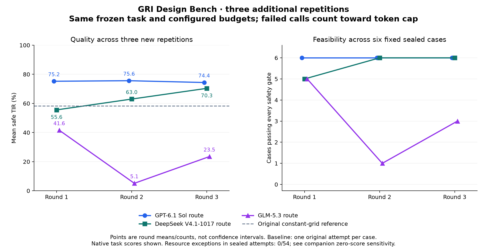

# Three additional repetitions

**108 planned attempts:** three routes × twelve fixed cases × three new contexts. All attempts, including failures, remain in the denominator. Original results are preserved separately.

The scientific contract and numeric budgets are unchanged. Failed requests now consume their reserved completion allowance. See the [pre-run plan](../../experiments/repeats-2026-11-11/plan.json) and [GLM diagnosis](../../docs/GLM_502_DIAGNOSIS.md).

## Sealed cases

| Requested route | Feasible /18 | R1 / R2 / R3 mean safe TIR (%) | Mean ± sample SD | R1 / R2 / R3 rank | API errors |
|---|---:|---|---:|---|---:|
| codex/gpt-6.1-sol | 18/18 | 75.22 / 75.59 / 74.37 | 75.06 ± 0.63 | 1 / 1 / 1 | 0 |
| wanjie/deepseek-v4.1-flash-1017 | 17/18 | 55.56 / 62.99 / 70.35 | 62.97 ± 7.40 | 2 / 2 / 2 | 0 |
| tokendance/glm-5.3 | 9/18 | 41.57 / 5.13 / 23.49 | 23.40 ± 18.22 | 3 / 3 / 3 | 24 |

Identical sealed-case ordering in all three rounds: **true**. Ranking is by feasible-case count first and mean safety-gated TIR second; ties share rank.

## Per-round orders

- repeat-20261111-r1: codex/gpt-6.1-sol > wanjie/deepseek-v4.1-flash-1017 > tokendance/glm-5.3
- repeat-20261111-r2: codex/gpt-6.1-sol > wanjie/deepseek-v4.1-flash-1017 > tokendance/glm-5.3
- repeat-20261111-r3: codex/gpt-6.1-sol > wanjie/deepseek-v4.1-flash-1017 > tokendance/glm-5.3

## Failure accounting on sealed cases

| Requested route | API error requests | Submission failures /18 | Simulation or infrastructure failures /18 | Safety failures /18 |
|---|---:|---:|---:|---:|
| codex/gpt-6.1-sol | 0 | 0 | 0 | 0 |
| wanjie/deepseek-v4.1-flash-1017 | 0 | 1 | 0 | 0 |
| tokendance/glm-5.3 | 24 | 3 | 0 | 6 |

API errors count requests and may coexist with a valid or failed design. The other columns count mutually exclusive trial outcomes. An association between API errors and low scores does not isolate a causal effect of the route.

## Within-case consistency

| Requested route | Cases feasible in all 3 / some / none | Mean within-case SD (percentage points) | Largest within-case range (percentage points) |
|---|---|---:|---:|
| codex/gpt-6.1-sol | 6 / 0 / 0 | 1.02 | 3.87 |
| wanjie/deepseek-v4.1-flash-1017 | 5 / 1 / 0 | 15.24 | 83.04 |
| tokendance/glm-5.3 | 1 / 5 / 0 | 23.60 | 84.78 |

These variability measures include zero scores from safety or submission failures. They describe repeated runs on the same six cases.

## Observed resource limits and sensitivity

1/108 attempts exceeded at least one recorded resource limit; [exact exceptions](resource-exceptions.json) are retained. Configured limits and the frozen monitor were unchanged.

Secondary sensitivity, added after observing a development CPU overrun; not preregistered.
Assign infeasible/zero in this view whenever any recorded CPU, wall, tool-wall, call or charged-token limit is exceeded. No tolerance and no dropped trials. Original native scores remain unchanged.

| Requested route | Resource exceptions (sealed /18) | Feasible /18 after zeroing | Mean safe TIR (%) | R1 / R2 / R3 rank |
|---|---:|---:|---:|---|
| codex/gpt-6.1-sol | 0 | 18/18 | 75.06 | 1 / 1 / 1 |
| wanjie/deepseek-v4.1-flash-1017 | 0 | 17/18 | 62.97 | 2 / 2 / 2 |
| tokendance/glm-5.3 | 0 | 9/18 | 23.40 | 3 / 3 / 3 |

Sealed ordering matches the primary analysis in rounds 1 / 2 / 3: [True, True, True]. Both splits are in [resource-sensitivity.csv](resource-sensitivity.csv).

## Fixed baseline reference

| Method | Feasible /6 | Mean safe TIR (%) |
|---|---:|---:|
| constant_grid | 5/6 | 58.26 |
| differential_evolution | 5/6 | 54.39 |
| sobol | 5/6 | 44.93 |

Baselines have one original run per case; these reference rows do not estimate baseline variance. The original pilot is kept in `summary.json` as a separate reference, not pooled as a fourth same-condition repetition.

## Evidence and limits

- [Independent audit](audit.json) checks native trajectories, every request ledger, exact planned coverage and preservation of the original result files.
- [Publication redactions](publication-redactions.json) remove private sealed bounds from exception text only. Numeric scores are unchanged; raw diagnostics and original exports remain private with hashes.
- [Round-level results](rounds.csv), [case variation](case-variation.csv), [paired comparisons](paired-comparisons.csv), and [full JSON](summary.json) include both development and sealed splits.
- Sample SD describes three observed round means. Six fixed cases and three repetitions do not establish a population ranking, statistical significance, unseen-patient generalization or clinical efficacy.
- Routes and provider-default inference settings are not independently authenticated model checkpoints. Token reservations include failed requests; billing is unavailable.
