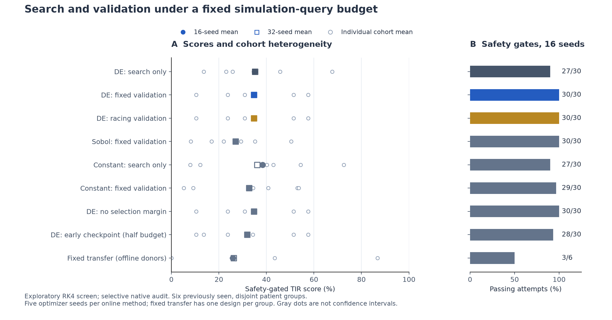
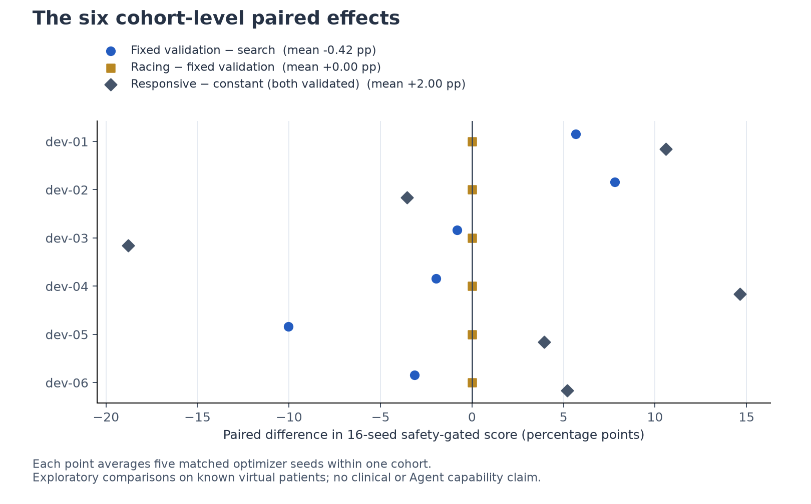

# 预筛结论：暂不进入自适应验证的论文主实验

2026-11-13。**本轮完成了基线、固定策略和消融的实现、运行及预定数值复核，但没有得到支持当前论文主张的证据。** 建议暂缓围绕“自适应分配搜索／验证预算优于固定策略”投入大规模 Agent 实验。保留这个研究问题，下一步优先排查候选搜索是否充分，而不是直接扩充模型排行榜。

这个判断针对本轮预算、候选生成器和验证策略。它不证明所有自适应策略都无效，也不证明整个项目没有论文价值。

## 本轮实际做了什么

六个已见开发患者组，共18名互不重叠的虚拟患者；每个随机方法五次优化器重复。八个在线方法／消融加一个固定迁移对照，共246条方法输出、115个唯一设计。另有六个历史高预算参考设计，只用于解释搜索是否达到较好区域。

主要方法各256查询单位；一个单位包含同一设计、同一进餐种子下的三患者×三变体。纯搜索评估128个候选；带验证方法评估64个候选，将其余预算用于验证八个入围设计。评测使用新的32个进餐种子，前16个为主面板。方案与算法在运行前本地冻结，选择结果经过独立账本复算。

这里的“分数”是安全门控后的TIR：任一轨迹违反既定低血糖门槛，该次尝试记零；否则取第2—3天TIR均值。通过数是对这组有限模拟情景的通过，不是临床安全率。

## 主结果

| 方法 | 16种子分数 | 通过次数 | 32种子分数 | 查询单位 |
|---|---:|---:|---:|---:|
| 响应式DE纯搜索 | 35.14 | 27/30 | 35.17 | 256 |
| 响应式DE＋固定验证 | 34.73 | 30/30 | 34.76 | 256 |
| 响应式DE＋逐级淘汰验证 | 34.73 | 30/30 | 34.76 | 256 |
| Sobol＋固定验证 | 26.99 | 30/30 | 27.03 | 256 |
| 恒速DE纯搜索 | 38.34 | 27/30 | 36.07 | 256 |
| 恒速DE＋固定验证 | 32.73 | 29/30 | 32.68 | 256 |
| 固定验证，去掉额外选择安全余量 | 34.73 | 30/30 | 34.76 | 256 |
| 响应式DE半预算检查点 | 31.86 | 28/30 | 31.92 | 128 |
| 排除目标组的历史参数中位数迁移 | 25.94 | 3/6 | 26.23 | 在线0，历史成本另计 |

固定验证相对纯搜索为 **−0.42个百分点**，六组中只有两组改善，未达到预定的“至少+5个百分点且至少四组改善”门槛。按六个患者组重采样的探索性95% bootstrap区间为[−5.05,+4.18]；样本很小，这不是有效性或等效性的确证。扩展到32种子后均差仍为−0.41。

逐级淘汰相对固定验证为 **0.00个百分点**，两者在全部30次配对运行中选出了完全相同的设计。因此当前数据不支持自适应验证的额外收益；这也只检验了本轮带零释放后备的具体淘汰策略。

固定迁移仅3/6组通过，均分25.94，未达到“距最佳响应式在线方法5个百分点以内且至少5/6组通过”的门槛。它否定的是这个原始参数中位数迁移基线，不能据此证明所有固定策略都弱。

## 消融解释与搜索瓶颈

**验证有局部作用，但本轮机会成本更大。** 固定验证与半预算检查点在28/30次中选出同一设计。改变的两次均位于dev-02，将门槛不通过的选择改为通过，得分分别为67.63和18.40；相对半预算检查点的平均收益为+2.87，但只集中在一组。与同预算、继续搜索至128候选的对照相比，这点收益不足以抵消其他组的候选质量损失。半预算检查点用于机制分析，不是等成本基线。

**安全余量消融没有形成有效区分。** 额外安全余量改为正式评分门槛后，30次选择全部不变。这表明本轮消融缺乏辨别力，不能解释成“余量没有用”。没有方法选中零释放后备，结果相同也不是全体退回零释放造成的。

**当前响应式机制没有稳健优势证据。** 在双方均带固定验证时，响应式比恒速平均高2.00个百分点，但六组差异有正有负，探索性区间为[−7.36,+9.72]。恒速纯搜索整体反而高于响应式纯搜索。两类参数空间维数不同，预算相同不代表优化充分程度相同；这里不能把求解器表现当作响应材料本身的优劣。

**候选生成方法值得优先检查。** DE固定验证高于Sobol固定验证7.73个百分点，且实例差异较大。预先另列的六个历史高预算、目标组专属设计在本轮新面板上全部通过，均分 **69.65**，32种子为 **69.61**，每一组均高于本轮响应式纯搜索的组均值。它们使用过目标患者组和更大历史计算量，不能作为同预算胜负对照，也不是任务上界；但其表现提示当前约24—25 CPU秒／方法的查询预算运行尚有很大搜索质量缺口。现阶段不宜把本轮实现称为已达到性能上限的“最强基线”。

## 验证完成情况

- 正式运行前，整个测试集52项通过，其中新增8项覆盖预算、候选前缀、迁移排除、消融及审计映射等关键逻辑。
- 独立复算30个搜索作业、240个在线方法输出、10,740条查询事件：选择与预算符合冻结方案。
- 主实验：按方案对每个唯一设计的首个评测种子及全部阈值附近轨迹做原生dopri5复核，共1,238条，安全分类差异为0。审计范围内TIR、TBR70、TBR54差异均为0，最低血糖最大差异0.000607 mg/dL。
- 六条未加速原始RHS对照全部一致，最大整条轨迹差异小于6×10⁻¹¹。历史参考设计另外复核54条，安全分类差异为0。
- 独立从数组复算全部1,298条原生轨迹指标，并复算121个设计的聚合分数；最大算术差异1.43×10⁻¹⁴以下。
- 生成数值摘要时，原有1,643个受保护文件摘要全部不变。最终检查时，并行的v0.2九模型任务已提交`1a23868`，更新了两份主README并新增其结果文件；其余1,641个受保护文件不变，包含本轮依赖的代码、实例及历史数值结果。旧README仍可从冻结时Git提交恢复，对方改动保持原样，详见[并发记录](workspace-concurrency.json)。这条记录描述的是数值审计结束时的本地工作区。

**主表仍是RK4筛查结果，经过选择性原生复核。** 因固定验证改善门槛未通过，按事前规则未触发主比较全部16种子的原生确认；这不是漏跑了一个已要求执行的阶段。数值复核不等于独立生理模型验证。

## 论文价值与下一步取舍

当前不具备支撑一篇“新自适应方法优于强固定基线”的充分结果；局部安全修复也不宜单独包装成普遍收益。选择乐观偏差、资源分配和随机约束择优已有直接近邻，本轮逐级淘汰是基线而非原创算法，见[相关工作核对](../../experiments/search-validation-prescreen-2026-11-13/RELATED_WORK.md)。例如[Optimizer’s Curse](https://pubsonline.informs.org/doi/10.1287/mnsc.1050.0451)与[非随机最佳臂识别](https://proceedings.mlr.press/v51/jamieson16.html)已经讨论相邻问题。

若继续投入，优先级应是一次独立、事先固定的小型**搜索充分性校准**：跨预算检查候选质量是否稳定；在共同候选池上比较验证策略以分离候选生成的影响，同时保留当前端到端等预算比较。当前32种子面板已经被查看，下一轮须重新生成独立评测面板；不要在它上面调参后继续称其为未见测试集。

只有当候选搜索足够强、固定与自适应选择仍产生可复现差异时，再加入未见患者组和更大情景变化，检验方法是否迁移。要主张Agent能力，还需同信息、同候选生成内核的决策对照。本轮没有测试新Agent，也没有检验可制造材料约束或外部生理有效性。这些是后续研究条件，不是已经获得的贡献。

本轮所有事前筛选门槛均未通过，因此到此交付预筛，不自动扩大Agent实验或发布成果。

## 可追溯材料

[冻结方案与复现命令](../../experiments/search-validation-prescreen-2026-11-13/README.md) · [全部结果](README.md) · [逐次输出](attempts.csv) · [配对效应](paired-cases.json) · [事后机制诊断](mechanisms.json) · [历史参考诊断](historical-reference.json) · [独立数值审计](numeric-audit.json) · [并发文件变化](workspace-concurrency.json)

完整搜索账本、筛查明细和原生数组位于`private/search-validation-prescreen-2026-11-13/`；报告中的机制解释属于事后描述，未修改冻结算法或决策规则。
