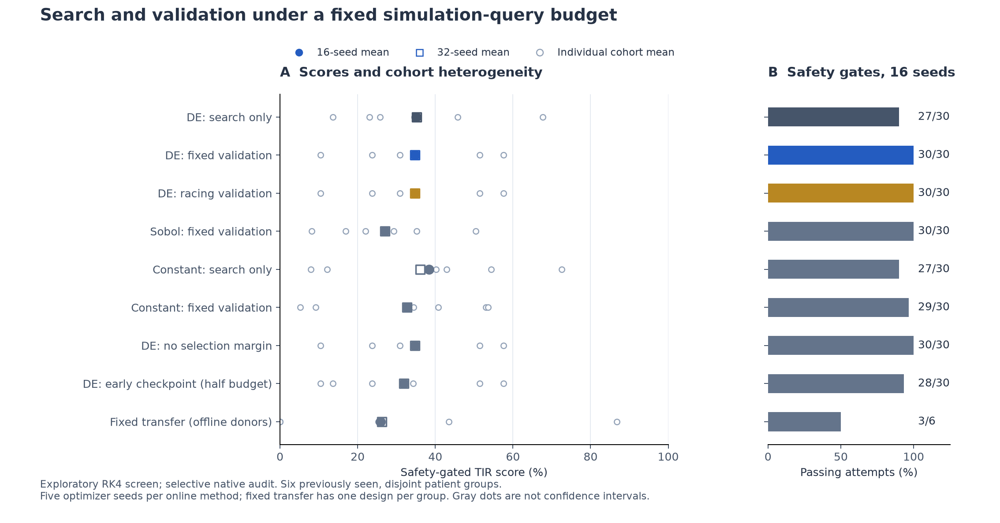
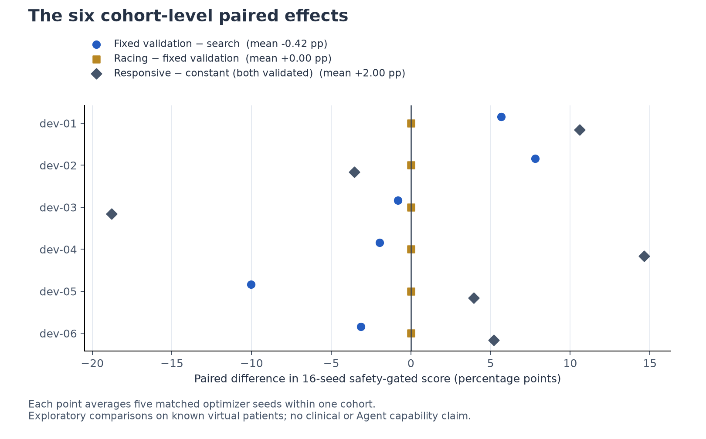

# 搜索与验证预算：无模型预筛结果

**结论：暂不进入自适应验证的论文主实验。** 固定验证提高了有限情景的通过数，但相对等预算纯搜索没有总分收益；逐级淘汰与固定验证30次选择完全相同。见[完整判断与消融解释](CONCLUSION.md)。

本轮为六个已见开发患者组上的探索性研究；进餐面板新生成并在运行前本地冻结。未测试新 Agent，未发布。
主分数由 RK4 筛查得到，原生积分器只复核预先指定的样本和全部阈值附近轨迹；不要把选择性复核称为全部设计原生验证。

| 方法 | 门槛通过 / 次数（16种子） | 全尝试分数 | 32种子分数 | 查询预算 |
|---|---:|---:|---:|---:|
| de_search | 27/30 | 35.14 | 35.17 | 256 |
| de_fixed | 30/30 | 34.73 | 34.76 | 256 |
| de_racing | 30/30 | 34.73 | 34.76 | 256 |
| sobol_fixed | 30/30 | 26.99 | 27.03 | 256 |
| constant_search | 27/30 | 38.34 | 36.07 | 256 |
| constant_fixed | 29/30 | 32.73 | 32.68 | 256 |
| de_no_margin | 30/30 | 34.73 | 34.76 | 256 |
| de_early | 28/30 | 31.86 | 31.92 | 128 |
| fixed_transfer | 3/6 | 25.94 | 26.23 | 0 |

## 冻结判定

- 固定验证改善门槛：False。
- 自适应验证额外改善门槛：False。
- 固定迁移接近在线最优门槛：False。
- 原生抽检 1238 条轨迹，安全分类差异 0；原始 RHS 对照 6 条。
- 完整主要比较原生确认：未触发。固定验证改善门槛未通过，按冻结规则到选择性数值复核为止。

这些门槛是预筛决策规则，不是显著性或等效性检验。对照按实例配对，五次重复不增加六个患者组的自由度。

## 主要比较（百分点）

| 比较 | 均差 | 正向实例 /6 | 32种子均差 |
|---|---:|---:|---:|
| de_fixed − de_search | -0.42 | 2 | -0.41 |
| de_racing − de_fixed | 0.00 | 0 | 0.00 |
| de_fixed − de_early | 2.87 | 1 | 2.84 |
| de_fixed − de_no_margin | 0.00 | 0 | 0.00 |
| de_fixed − sobol_fixed | 7.73 | 4 | 7.73 |
| de_fixed − constant_fixed | 2.00 | 4 | 2.08 |
| constant_fixed − constant_search | -5.62 | 0 | -3.39 |
| fixed_transfer − de_fixed | -8.79 | 2 | -8.53 |

## 解释边界

- 固定验证、逐级淘汰与纯搜索的主预算相同，但候选数和独立验证面板分配不同。de_early 只有半预算；de_no_margin 只改验证选择门槛；两者是机制消融。
- 固定迁移排除目标实例设计，使用其他五例的历史精修设计中位数并裁剪到目标边界。在线零查询不等于历史计算成本为零，且这些患者组不是全新外部人群。
- CPU 表用于资源描述；相同查询数不保证相同 CPU，更不等于原 v0.2 的30 CPU秒。本表不能直接与历史 Agent 排行榜作公平胜负判断。
- 同一生理模型、六个已见患者组、小样本、单一参数包络体系；条件TIR与门槛通过率须同时解释，不推断临床安全。
- 生成数值摘要时原有1643个受保护文件摘要未变；最终检查时，并行任务提交`1a23868`更新两份主README，其余1641个文件（含旧代码和数值结果）仍未变。没有回退并行改动，见[并发记录](workspace-concurrency.json)。

[机器可读摘要](summary.json) · [逐次结果](attempts.csv) · [32种子敏感性](expanded32.csv) · [逐实例配对](paired-cases.json) · [原生抽检](native-audit.csv)

## 补充审计与图表

[事后机制诊断](mechanisms.json) · [独立数值复算](numeric-audit.json) · [历史高预算参考诊断](historical-reference.json) · [冻结方案](../../experiments/search-validation-prescreen-2026-11-13/README.md)

历史参考为六例69.65分、6/6通过，使用过目标组与高预算，不进入上表等预算比较。主实验1,238条原生复核、6条原始RHS对照、参考诊断54条，共1,298条保存数组；独立复算全部数组及121个设计聚合分数通过。没有对所有评测轨迹做原生积分，未做新患者外部验证。

可编辑矢量图：[比较图](comparison.svg) · [配对图](paired-effects.svg)。
